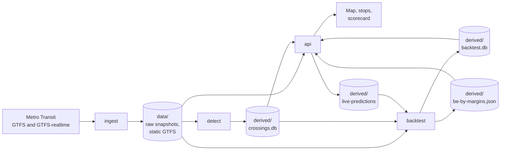
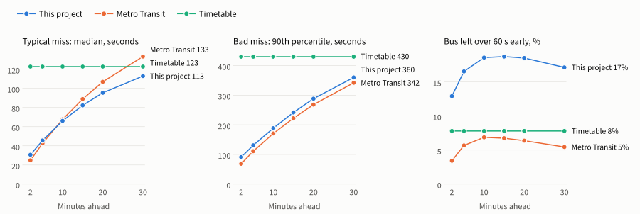
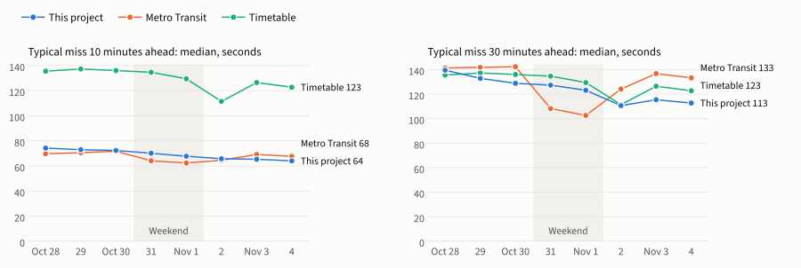

# HowIRide2

Segment-based arrival predictions for Metro Transit (Minneapolis–St. Paul), learned from live GPS and recorded history rather than taken from the timetable.

It records the agency's realtime feeds, works out when each vehicle actually passed each point on its route, predicts departures from that history, and scores every prediction against what the bus then did.
Riders get a live map, per-stop departures, and a "be there by" time with a measured risk of missing the bus.

The code calls itself `transit-eta`: that's the solution, the `Transit` library, and the directory the deploy unit expects.

<!-- TOC -->
- [How it works](#how-it-works)
- [Results so far](#results-so-far)
  - [How it gets better](#how-it-gets-better)
- [Next: machine learning](#next-machine-learning)
- [Repository layout](#repository-layout)
- [Getting started](#getting-started)
  - [Prerequisites](#prerequisites)
  - [Run the stack](#run-the-stack)
  - [What works when](#what-works-when)
- [Configuration](#configuration)
- [Ingest](#ingest)
- [Crossings](#crossings)
- [Prediction models](#prediction-models)
  - [What the timetable does](#what-the-timetable-does)
  - [Trips that haven't started](#trips-that-havent-started)
  - [Be there by](#be-there-by)
- [Backtest](#backtest)
  - [Scoring rules](#scoring-rules)
  - [Nightly scoring](#nightly-scoring)
  - [What riders actually saw](#what-riders-actually-saw)
- [Live map and API](#live-map-and-api)
- [Development](#development)
- [Deployment notes](#deployment-notes)
- [License](#license)
<!-- /TOC -->

## How it works



There is no public archive of realtime history, so recording it comes first.
Everything else is derived from that recording and can be rebuilt from it.

| Component | Runs as | Job |
|---|---|---|
| `ingest` | Always-on service | Archives the feeds byte for byte. Nothing else may slow it down or take it out. |
| `detect` | Always-on service | Turns vehicle pings into checkpoint crossings. Mounts `data/` read-only, so it can't damage the recording. |
| `api` | Always-on service, port 8080 | Serves live positions, predictions and the web app, and logs what it predicted. |
| `backtest` | Nightly timer or on demand | Scores predictors against observed departures and relearns the "be there by" margins. |
| `detect-grid` | Off by default | Experiment: the same detection on a shared map grid. A week in, it scored worse than the default layout. |
| `replay` | Local tool | Replays recorded hours into a CSV for inspection. |

## Results so far

Recording began in late October 2026, so these are early numbers: eight service days and 2.2 million scored bus departures, up to 4 November.

On weekdays, the project now beats Metro Transit's own predictions on the typical miss from about 10 minutes ahead, by about 20 seconds at 30 minutes.
It doesn't beat Metro Transit everywhere yet:

- **Close in:** Metro Transit is better at 2 and 5 minutes ahead.
- **Bad misses:** Metro Transit's 90th percentile is lower at every horizon.
- **Leaving early:** the bus leaves more than 60 s before the shown time about three times as often with these predictions.
- **Weekends:** Metro Transit won the typical miss on the only weekend scored so far.

<picture>
  <source media="(prefers-color-scheme: dark)" srcset="docs/charts/by-horizon-dark.svg">
  
</picture>

What riders were shown on Wednesday 4 November, buses only:

| Minutes ahead | Median miss, s: this project / Metro Transit | 90th percentile, s: this project / Metro Transit | Left early: this project / Metro Transit |
|---|---|---|---|
| 2 | 31 / 25 | 91 / 69 | 13% / 3% |
| 5 | 46 / 42 | 131 / 111 | 17% / 6% |
| 10 | 66 / 68 | 189 / 171 | 19% / 7% |
| 15 | 82 / 89 | 242 / 222 | 19% / 7% |
| 20 | 95 / 107 | 288 / 268 | 18% / 6% |
| 30 | 113 / 133 | 360 / 342 | 17% / 5% |

The timetable, which doesn't change with how far ahead you look, scored a 123 s median, a 430 s 90th percentile and 8% early.
Replayed by route that day, with 100 routes having enough data, this project had the lower median on 62 at 10 minutes and 71 at 30 minutes, but the lower early rate on only 3.

Part of Metro Transit's advantage on leaving early comes from predicting too soon: at 30 minutes its prediction averaged 145 s before the actual departure, against 94 s here.
That usually costs a rider a wait rather than a bus.
The [be there by](#be-there-by) time is this project's answer: on a held-out weekday the bus was gone first for 2.7% of views, against 32.6% for the estimate alone.
Its margins were fitted on weekdays only, so weekends are untested.

### How it gets better

<picture>
  <source media="(prefers-color-scheme: dark)" srcset="docs/charts/by-day-dark.svg">
  
</picture>

Each day replayed with only the days before it, buses at 30 minutes ahead:

| Service day | Median miss, s: this project / Metro Transit | 90th percentile, s: this project / Metro Transit | Left early: this project / Metro Transit |
|---|---|---|---|
| Wed Oct 28 | 140 / 141 | 433 / 355 | 18% / 5% |
| Thu Oct 29 | 133 / 142 | 410 / 362 | 19% / 5% |
| Fri Oct 30 | 129 / 142 | 410 / 368 | 22% / 6% |
| Sat Oct 31 | 127 / 108 | 397 / 321 | 16% / 16% |
| Sun Nov 1 | 123 / 103 | 386 / 301 | 19% / 18% |
| Mon Nov 2 | 111 / 124 | 353 / 322 | 24% / 7% |
| Tue Nov 3 | 115 / 137 | 366 / 353 | 19% / 6% |
| Wed Nov 4 | 113 / 133 | 364 / 342 | 18% / 5% |

Against Metro Transit as a control for how hard each day was, the weekday median went from level to about 20 s ahead, and the gap in the 90th percentile narrowed from 78 s to 22 s.
Three things help:

- **More history, up to a point.** The tables fill in as days are recorded, and a cell is trusted once it has 3 samples. Much of the first week's gain arrived in that one step rather than as steady learning, and the tables only look back 14 days, so more recording alone will level off.
- **Scoring shows what to fix.** Every prediction is checked against what the bus did, and rules like the [ones for trips that haven't started](#trips-that-havent-started) came from that. The code changed during these days, so this table isn't a pure measure of learning.
- **Each day teaches the live model.** It rebuilds its tables hourly, including today so far, and its pace reading updates every minute.

The early rate hasn't improved: it was 18% on the first day and on the last.
Much of the median's gain came from no longer predicting departures so far ahead of when buses actually leave, which also sends more buses off before the time shown.
Eight days is too few to call any of this a trend, so compare fixed test days and hours, use Metro Transit as the control, and report the early rate and 90th percentile alongside the median.

## Next: machine learning

The models so far are hand-built: medians plus rules.
What's left in their errors is likely to take combinations those rules can't express, like a late bus running close behind another on a route that's behind all afternoon.

So the next step is a trained model that corrects v1 rather than replacing it.
An experiment is under way with gradient-boosted trees (LightGBM), trained on earlier service days and tested on later ones:

- **It learns v1's remaining error,** from what's known when a prediction is made: the lead shown, stops and distance left, the delay so far, today's pace, the gap to the bus ahead, the time and type of day, and the route.
- **Predictions are sampled on a fixed clock,** as a rider would see them. Sampling at set times before the actual departure would let a model learn to round to those times and look better than any rider would find it.
- **The bar is deliberately high:** at least 10% lower early rate and 90th percentile than v1, with no worse a median, on every held-out day, and better than simple baselines. Those are the two measures where Metro Transit still leads.

There are no results to report yet, and it may not clear that bar.
More data is what gives it a chance: the archive so far covers one season, one weekend and no major holidays, and a trained model can keep learning from older days where v1's tables stop at 14.
Because the raw feeds are kept, every day recorded now can be replayed as training data later.

## Repository layout

| Path | Contents |
|---|---|
| [`src/Ingest`](src/Ingest) | Feed poller and static GTFS watcher |
| [`src/Detect`](src/Detect) | Worker that writes `crossings.db` |
| [`src/Api`](src/Api) | ASP.NET Core API, and host for the web app |
| [`src/Backtest`](src/Backtest) | Scoring command line |
| [`src/Replay`](src/Replay) | Archive-to-CSV command line |
| [`src/Transit`](src/Transit) | Shared library: archive format, GTFS, map matching, crossing detection, prediction models, scoring |
| [`web`](web) | React, MapLibre and Vite front end |
| [`tests`](tests) | xUnit suites for `Ingest` and `Transit` |
| [`deploy`](deploy) | systemd unit and timer for the nightly backtest |
| [`proto`](proto) | The upstream GTFS-realtime schema, under its own Apache 2.0 license |
| [`docs/charts`](docs/charts) | The README's charts, their data snapshot and the script that draws them |
| [`docs/superpowers`](docs/superpowers) | Design notes and plans for individual features |

`data/` and `derived/` are created at run time and are not in the repository.

## Getting started

### Prerequisites

- Docker with Compose, to run the stack.
- The .NET 10 SDK and Node 22, to develop or run tools outside Docker.
- `zstd`, only to inspect closed archive hours from the shell.
- An SSD for `data/`: see [the expected volume](#what-to-expect).

The feeds are public and need no API key.

### Run the stack

```sh
git clone https://github.com/CipherLab/HowIRide2 transit-eta
cd transit-eta

docker compose up -d --build ingest    # start recording and fetch the static GTFS
ls data/static/metro-gtfs              # wait until a .zip appears
docker compose up -d --build           # add detect and api
```

Then open `http://<node>:8080`.
`detect` and `api` read the static GTFS that `ingest` downloads, which is why `ingest` goes first.

`docker compose run --rm -T backtest` scores yesterday on demand.
`docker compose --profile experiments up -d detect-grid` starts the grid experiment.

### What works when

The project learns from its own recording, so a new install starts with little to show.

| After | You get |
|---|---|
| Minutes | Live vehicles on the map, and Metro Transit's predictions and the timetable at each stop. |
| Days | The first useful estimates: a day type and 15-minute slot needs 3 samples before its median is trusted, and sparser cells fall back to broader ones. |
| A first night's backtest | The scorecard and charts. |
| A night's backtest with a live prediction log | "Be there by" times. None are offered until `derived/be-by-margins.json` exists. |

History builds up per day type, so Saturdays and Sundays take weeks to catch up with weekdays.

## Configuration

Each service reads its section of `appsettings.json`, overridable by environment variable (`Ingest__DataDir=/mnt/ssd/transit`) or, under `dotnet run`, by argument (`--Api:DbPath=<path>`).

| Setting | Default | Meaning |
|---|---|---|
| `Ingest:DataDir` | `data` | Root of the recording |
| `Ingest:PollInterval` | 5 s | How often each realtime feed is fetched |
| `Ingest:StaticCheckInterval` | 6 h | How often static GTFS is checked for a new version |
| `Ingest:Realtime`, `Ingest:Static` | Metro Transit's feeds | Feed names and URLs; the name is also the directory on disk |
| `Detect:DataDir` | `data` | Recording to follow, read-only |
| `Detect:DbPath` | `derived/crossings.db` | Database it writes |
| `Detect:PollInterval` | 2 s | How often it looks for new records |
| `Api:DataDir`, `Api:DbPath`, `Api:BacktestDbPath` | Under `data` and `derived` | Inputs |
| `Api:HistoryDays` | 14 | Days of crossings the live models learn from |
| `Api:PredictionLogDir` | Set in `docker-compose.yml` | Where to log what riders were shown |
| `Api:BeByMarginsPath` | Set in `docker-compose.yml` | Margins learned by the nightly backtest |
| `TRANSIT_CHECKPOINTS` | `spaced` | Checkpoint layout, `spaced` or `grid`. Every process reading a crossings database must use the mode that wrote it. |

## Ingest

Polls the three GTFS-realtime feeds every 5 s and archives every snapshot whose header timestamp is new.
Also keeps a versioned copy of every static `gtfs.zip` and `next/gtfs.zip` it sees.

The bytes are stored as received, not parsed, so a bug in crossing detection is fixed by replaying the archive rather than lost.

```
data/
  raw/{feed}/{yyyy-MM-dd}/{HH}.pbs       current UTC hour, appended live
  raw/{feed}/{yyyy-MM-dd}/{HH}.pbs.zst   closed hours, zstd level 19, 128 MB long window
  static/{feed}/{Last-Modified}.zip      one file per published GTFS version
```

Record format: `[int64 BE fetched-at unix ms][int32 BE length][GTFS-rt FeedMessage bytes]`, repeated.
`RawArchiveReader.Read(path)` reads either form and stops cleanly at a record torn by a crash.
From the shell: `zstd -d --long=27 -c 16.pbs.zst > 16.pbs`.

To run it alone, `dotnet run --project src/Ingest` writes to `./src/Ingest/data`.

### What to expect

Measured 2026-10-27, midday weekday:

| Feed | New snapshot every | Size per snapshot | Compressed per day (est.) |
|---|---|---|---|
| tripupdates | ~10 s | ~900 KB | ~0.5 GB |
| vehiclepositions | ~10 s | ~67 KB | ~0.07 GB |
| alerts | ~50 s | ~120 KB | small |

The current hour is uncompressed (~330 MB for tripupdates) before it rolls over.
Put `data/` on an SSD rather than a Raspberry Pi's SD card.
Nothing prunes the archive, so it keeps growing until you remove old hours yourself.

Metro Transit returns sporadic 404s while regenerating feeds; the poller logs them and backs off.
`next/gtfs.zip` also returns 404 for most of the week, which is expected.

## Crossings

`src/Transit` turns vehicle pings into checkpoint crossings, the history every model is trained on.

1. **Checkpoints** per (shape, stop list) pattern: every stop, plus a synthetic point every ~300 m where stops are more than 600 m apart.
   Stop distances come from `stop_times.shape_dist_traveled` (meters in Metro Transit's feed).
2. **Map matching** projects each ping onto its trip's shape, searching only a window around the last position so loops and parallel streets can't steal the match.
   Within 35 m of the shape moves the vehicle; 35-75 m is ignored as noise; beyond 75 m is off-route and flags the next crossing as a detour.
3. **Crossing times** are interpolated where consecutive pings straddle a boundary.
   Each stop has a ±30 m zone: entering it is arrival, leaving it is departure, the difference is dwell.
   Segment travel is departure from one zone to arrival at the next.

### Live: the `detect` service

`detect` follows the VehiclePositions archive (closed hours, then the live file), runs the detection, and writes `derived/crossings.db` (SQLite, WAL, safe to read while it runs).

- **Resume:** a cursor is stored with each snapshot's rows in one transaction. On restart it replays the previous 90 minutes without writing, so trips already under way keep their tracking state.
- **Static GTFS:** the newest `gtfs.zip` and `next/gtfs.zip` are both loaded and checked hourly, so trips from an upcoming pick resolve as soon as it's published.
- **Rebuild:** delete `derived/crossings.db` and restart; it re-derives everything from the archive.

Segment travel times, the raw material for the models:

```sql
SELECT c.prev_checkpoint_id, c.checkpoint_id, c.arrive - p.depart AS seconds
FROM crossings c JOIN crossings p
  ON p.service_date = c.service_date AND p.trip_id = c.trip_id AND p.checkpoint_index = c.checkpoint_index - 1
WHERE c.detour = 0 AND c.arrive IS NOT NULL AND p.depart IS NOT NULL;
```

### Offline: replay to CSV

```sh
dotnet run --project src/Replay -c Release -- <data-dir> 2026-10-27T16 2026-10-27T18 crossings.csv
REPLAY_TRACE=10,902 dotnet run ...   # also writes every ping on those routes to crossings.csv.trace.csv
```

One row per (trip, checkpoint): `arrive_unix` is empty at a trip's first stop, `depart_unix` at its last.
`*_gap_s` is the gap between the two pings a time was interpolated from; weight long gaps down.
The replay prints matcher health (off-route, ambiguous, and *lost* pings, which should stay near zero) and implied segment speeds.

## Prediction models

Both models predict a departure from the same walk along the trip, in [`SegmentEtaPredictor`](src/Transit/Eta/SegmentEtaPredictor.cs).
They start at the bus's last known departure and add, for each segment still ahead, its travel time plus the dwell at each stop, including the target stop's own dwell.

- **`v0-medians`** uses historical medians by segment, day type and 15-minute slot.
  A sparse cell falls back to nearby slots, then the whole day type, then all days.
  A segment with no history at all assumes 7 m/s and 8 s of dwell.
  A date's day type is what its timetable runs as, not just its weekday: [`ServiceDays`](src/Transit/Gtfs/ServiceDays.cs) compares the trips each archived GTFS feed runs that date with its usual Saturday, Sunday and own-weekday timetables, so Thanksgiving on Sunday service learns from and predicts with Sundays.
- **`v1-pace`** scales those medians by [today's pace](src/Transit/Eta/RecentPace.cs): how traversals finished in the last 30 minutes compare with their own medians, on that segment and its neighbours within 1.5 km.
  Snow, a crash or a game letting out show up here without being modeled.
  With little evidence it assumes a normal day, and the effect fades with distance ahead of the bus.
  It also applies the rules below for trips that haven't started.

The live API serves v1, relearning its tables hourly from the last 14 days of crossings.
A crossing counts only from when an app could first have known it, one ping interval plus the feed's lag after it happened, so a backtest can't see the future.

### What the timetable does

Once a bus is under way, the timetable plays no part in its prediction.
The walk starts from where the bus was last seen and uses only recorded travel and dwell times, so a bus running 10 minutes late is predicted from where it actually is.

The timetable still matters in two places:

- **Trips that haven't started:** with no bus to follow, the estimate starts from the scheduled first departure plus [the delay learned for it](#trips-that-havent-started).
- **The plan itself:** static GTFS supplies which trips exist, their stops and shapes, and which trips a bus works in sequence.

### Trips that haven't started

Most of the error on a trip that hasn't started is the guess of when it will, so that's learned rather than read off the timetable:

- **Usual start:** the median delay from the timetable at that first stop, by day type and 15-minute slot, from history.
- **Bus still out:** it can't start before the previous trip in its block finishes, plus a minute's layover.
- **Previous trip never seen,** 15 minutes past its start: cancelled or run by another bus, so the next trip stops waiting for it.
- **Overdue and unseen,** 5 minutes past the usual start: predicted as if it left on time, because tracking often begins a few stops in.

Only crossings knowable at the query time count as seen; a replay's store also holds later ones.

### Be there by

An estimate is a best guess, so about a third of buses leave before it.
Departures also show a time to be at the stop by, the estimate less a margin learned from `derived/live-predictions`: what riders were shown against what the bus then did, from the last 7 days.

- **By** whether the trip had started and the time shown. Bus-gone-first risk is 5% in each cell.
- **Routes** with enough samples can raise their margin but never lower it, because one good day isn't evidence a route is safer than the rest. So overall risk runs below 5%, at about 3%.
- **Risk here is strict:** the bus had left at all, with no minute's grace. Views after it had already gone don't count; nobody could have caught it.

The nightly run prints how yesterday's margins did on the day before relearning them, to `journalctl -u transit-backtest.service`, and saves `derived/be-by-margins.json`.
The API reloads it hourly and offers no time until it exists.

## Backtest

Scores predictors against observed departures (the moment a bus leaves a stop's zone), by how far ahead they were predicting: 2, 5, 10, 15, 20 and 30 minutes.
The latest numbers are in [Results so far](#results-so-far).

```sh
dotnet run --project src/Backtest -c Release -- --data <data-dir> --db <crossings.db> --test 20261027
```

| Option | Effect |
|---|---|
| `--test <from>[..<to>]` | Service dates as `yyyyMMdd`, or an ISO instant to test everything after it |
| `--yesterday` | Yesterday's service date in the agency's time zone, instead of `--test` |
| `--train-days <n>` | Days of history before the test window to learn from (default 14) |
| `--store <path>` | Cache of replayed predictions and score history (default `backtest.db` beside `--db`) |
| `--routes-csv <path>` | Also write every score broken down by route |
| `--learning-curve` | Also score v1 with tables from 25% and 50% of the training trips |
| `--corrections` | Also fit and score `+cap` and `metro+median`. This predicts every training day and takes hours on a Pi, so run it elsewhere. |
| `--live-log <dir>` | Also score what the live API predicted |
| `--fit-margins <path>` | With `--live-log`, relearn the "be there by" margins |
| `--checkpoint-report` | Just print how many road segments each checkpoint layout shares between routes |

### Scoring rules

- **Target is departure**, because that's what Metro Transit's TripUpdates publish (arrival times appear on ~2% of stop updates) and what a rider boards on. First and last stops and detoured crossings are excluded.
- **Only the latest snapshot counts.** At each horizon a predictor's answer is what the newest TripUpdates snapshot said; if the trip had dropped out of it, there is no prediction. A latest snapshot more than 60 s old is treated as an archive gap.
- **Contenders:** the printed `schedule`, `metro-tripupdates`, `v0-medians`, `v1-pace`, `v1-mean` (v1 on trimmed means), and `live-v1` with `--live-log`. On days that run as a weekend, also `v1-wkpool`, where a sparse Saturday or Sunday cell borrows the other weekend day's cell at that time before the whole day, and `v1-wkday`, which then tries weekdays at that time. New models implement `IPredictor` and are scored the same way.
- **Metrics:** coverage, median and p90 absolute error, bias (mean of predicted minus actual), share within ±1 and ±2 minutes, and the *early* rate: the bus left more than 60 s before the predicted time.

### Nightly scoring

`deploy/transit-backtest.timer` scores yesterday at 04:30 Central and appends to `derived/backtest.db`, which feeds the scorecard and charts.

```sh
sudo cp deploy/transit-backtest.* /etc/systemd/system/
sudo systemctl daemon-reload
sudo systemctl enable --now transit-backtest.timer
journalctl -u transit-backtest.service     # last night's scores
```

The unit's `WorkingDirectory` is `/home/admin/transit-eta`; change it if the checkout lives elsewhere.

The container is limited to two cores and a 3 GB heap, and is the first thing killed if the node runs out of memory, so it can't cost a recording.

### What riders actually saw

The API writes what v1 is predicting to `derived/live-predictions` once a minute, in the raw archive format above: every stop of every trip due within 45 minutes, including trips that haven't started.
With `--live-log <dir>` the backtest scores that log as `live-v1`, by the same latest-sample rule as Metro's feed: a sample more than 90 s old at the query time counts as no prediction.

`v1-pace` is a replay that learns only from earlier days; `live-v1` is what was on screen, from tables that also include today so far.
A gap between them means the replay isn't telling the truth about production.

## Live map and API

The API follows the archive like `detect` does (its own detector instance for live positions, the TripUpdates feed for Metro Transit's predictions) and reads `crossings.db` hourly to rebuild the v0/v1 tables.
It serves a React app (`web/`) built into its `wwwroot`.

- **Live map:** every vehicle placed by distance along its real shape, replayed ~15 s behind the newest ping so it glides between GPS reports. Dot colour is today's pace on the road ahead; the ring is the route colour.
- **Stop:** zoom in and tap a stop, or open `#stop/<id>`. Each departure shows our estimate (amber dot), Metro Transit's (ring) and the timetable (tick) on one minutes-ahead strip.
- **Vehicle:** tap a bus or open `#vehicle/<id>` for its route line and next stops.
- **Watching a stop:** the search box at the top right finds a stop by route, name or number, with your recent picks and nearby routes. It then shows that stop and the next two buses on one route and direction, each with its time riding on it, framed automatically until you drag or zoom. Open `#watch/<stop>/<route>/<direction>` directly to save one.
- **Scorecard:** `#scorecard`, the latest backtest by horizon plus live matcher health.
- **Charts:** `#charts`, score history from the nightly backtest, overall and route by route.

| Endpoint | Returns |
|---|---|
| `GET /api/health` | Live matcher and feed health |
| `GET /api/vehicles`, `/api/vehicles/{id}` | Current vehicles, or one with its next stops |
| `GET /api/stream` | Server-sent events, one snapshot per feed update |
| `GET /api/routes`, `/api/routes/{id}/directions` | Routes and their directions |
| `GET /api/shapes/{id}` | A route shape |
| `GET /api/stops?bbox=s,w,n,e` | Stops in a bounding box |
| `GET /api/stops/search?q=` | Stops by route, name or number |
| `GET /api/stops/{id}` | Departures; add `?route=<id>&direction=<n>` to filter |
| `GET /api/stops/{id}/lines` | The route and direction pairs serving a stop |
| `GET /api/scores`, `/api/scores/routes` | Backtest scores, overall and by route |

## Development

Develop the UI with hot reload against a local API:

```sh
dotnet run --project src/Api -- --Api:DataDir=<data> --Api:DbPath=<crossings.db> --Urls=http://127.0.0.1:5199
cd web && npm install && npm run dev
```

Vite proxies `/api` to port 5199; set `API_URL` to point it elsewhere.

| Command | Checks |
|---|---|
| `dotnet test TransitEta.slnx` | Archive format, map matching, crossing detection, models, scoring and API state |
| `npm test` in `web/` | The rules for what the screen shows |
| `npm run lint` in `web/` | oxlint |
| `npm run build` in `web/` | Type-checks and builds into `src/Api/wwwroot` |

To update the README's charts, replace [`docs/charts/scores.csv`](docs/charts/scores.csv) and run [`docs/charts/make_charts.py`](docs/charts/make_charts.py), which needs matplotlib.

New predictors implement `IPredictor` in [`src/Transit/Backtest`](src/Transit/Backtest) and are added in [`src/Backtest/Program.cs`](src/Backtest/Program.cs).

## Deployment notes

The stack is built to run on a small always-on node, and runs on a Raspberry Pi CM4.
The Dockerfiles build natively on arm64, or with `docker buildx build --platform linux/arm64`.

- **Update without risking the recording:** run `docker compose build api`, then `docker compose up -d --no-deps api`. `ingest` and `detect` keep running, and a failed build leaves the old version up.
- **Memory limits:** a Pi that boots with `cgroup_disable=memory` ignores Docker's memory limits, so the backtest's heap is capped by .NET itself (`DOTNET_GCHeapHardLimit`) and `oom_score_adj` makes it the first thing killed.
- **Reading live databases:** copy `crossings.db` with the SQLite backup API rather than as a file, because it's in WAL mode.
- **Exposure:** the API has no authentication and serves plain HTTP on port 8080, so keep it on a LAN or behind a reverse proxy. TLS isn't part of this repository.

## License

[MIT](LICENSE), except [`proto/gtfs-realtime.proto`](proto/gtfs-realtime.proto), which keeps its upstream Apache 2.0 license.
The license covers this code only, not Metro Transit's feeds or anything recorded from them.
